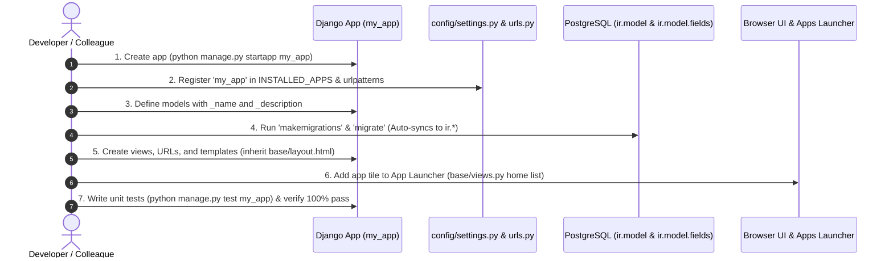

# Office Pro — Enterprise ERP & Office Management Platform

**Office Pro** is a modern, modular, enterprise-grade Office Management and ERP suite built with **Django**, **PostgreSQL**, and an **Odoo-inspired UI/UX framework**.

The platform is architected around a **Zero-Touch Modular Design**: the core engine (`base`) provides authentication, security, multi-company handling, technical registries, and UI widgets, while independent business modules (such as Webmail, Employee Management, Projects & Timesheets, Attendance, Leave/Time Off, Expenses, and Accounting/Invoicing) plug into the platform seamlessly without modifying a single line of core code.

---

## Table of Contents

1. [What Are We Doing in This Project?](#1-what-are-we-doing-in-this-project)
2. [How Are We Doing It? (Architecture & Technical Foundation)](#2-how-are-we-doing-it-architecture--technical-foundation)
3. [Based on What We Are Doing (Design Rationale & Core Principles)](#3-based-on-what-we-are-doing-design-rationale--core-principles)
4. [Application Functional Requirements (What Colleagues Have to Build)](#4-application-functional-requirements-what-colleagues-have-to-build)
   - 4.1 [Employee Management (`employee`)](#41-employee-management-employee)
   - 4.2 [Project & Timesheet Management (`project`)](#42-project--timesheet-management-project)
   - 4.3 [Attendance Management (`attendance`)](#43-attendance-management-attendance)
   - 4.4 [Leave / Time Off Management (`leave`)](#44-leave--time-off-management-leave)
   - 4.5 [Expense Management (`expense`)](#45-expense-management-expense)
   - 4.6 [Accounting & Invoicing (`accounting`)](#46-accounting--invoicing-accounting)
5. [Consolidated Roles & Permissions Matrix](#5-consolidated-roles--permissions-matrix)
6. [What is the Step-by-Step Process? (End-to-End Developer Workflow)](#6-what-is-the-step-by-step-process-end-to-end-developer-workflow)
7. [Technical Subsystems & Features](#7-technical-subsystems--features)
8. [UI & Component Design System](#8-ui--component-design-system)
9. [Project Directory Structure](#9-project-directory-structure)
10. [Local Setup & Verification](#10-local-setup--verification)

---

## 1. What Are We Doing in This Project?

We are building a unified, extensible ERP and business operations platform that replaces fragmented third-party SaaS tools with an integrated, high-performance web workspace tailored to company operations.

### Core Objectives:
- **Comprehensive Office Suite**: Provide full business modules for **Webmail**, **Employee Directory**, **Projects & Timesheets**, **Attendance Tracking**, **Leave Management**, **Expense Claims**, and **Accounting & Invoicing**.
- **Odoo-Style Developer & Admin Experience**: Provide runtime inspectability (`?debug=1`), dynamic record rules, scheduled cron jobs, automated sequence numbering, and database-registered models/fields.
- **Enterprise-Grade UI/UX**: Deliver responsive 3-pane layouts, interactive popovers (Conversations, Activities), live wallpaper theming (Odoo Purple, Dark Slate, Ocean Blue, Emerald), and keyboard-friendly workflows.
- **Team-Scalable Engineering**: Allow multiple developers to independently build and ship business modules simultaneously without merge conflicts or shared core regressions.

---

## 2. How Are We Doing It? (Architecture & Technical Foundation)

The platform is structured into two distinct tiers: **Core Engine** and **Business Apps**.

```mermaid
graph TD
    subgraph CoreEngine ["Tier 1: Core Framework (base & authentication)"]
        AUTH[Authentication & Users (res.users, res.groups)]
        COMP[Multi-Company Hierarchy (res.company)]
        REG[Technical Metadata Registry (ir.model, ir.model.fields, ir.module)]
        SEC[Security Engine (ir.rule, ir.model.access)]
        CRON[Background Cron Scheduler (ir.cron)]
        UI[Design System & Widgets (Many2One, Search Panels, Form Sheets)]
    end

    subgraph BusinessApps ["Tier 2: Business Apps (Standalone Modules)"]
        MAIL[Webmail Suite (mail)]
        EMP[Employee Management (employee)]
        PROJ[Project & Timesheets (project)]
        ATT[Attendance (attendance)]
        LEAVE[Leave & Time Off (leave)]
        EXP[Expense Claims (expense)]
        ACC[Accounting & Invoicing (accounting)]
    end

    BusinessApps -->|Auto-Discovered on migrate| REG
    BusinessApps -->|Inherits UI, Layouts & Themes| UI
    BusinessApps -->|Enforces Permissions & Row Security| SEC
```

### Key Architectural Pillars:
1. **Metadata-Driven Engine**: Every Django model across all apps is dynamically discovered upon `python manage.py migrate` and synchronized into `ir.model` and `ir.model.fields`.
2. **Zero-Touch App Discovery**: New business apps register in `INSTALLED_APPS` and define their models; the core system handles registry discovery, Many2One search dialogs, and permission assignment automatically.
3. **Decoupled Business Modularity**: Business apps live in their own directory with their own models, views, templates, static assets, and automated tests.
4. **Unified Topbar & Chatter Engine**: Standardized topbar popovers for Conversations (Direct Chat, Chatter feed) and Activities (Overdue, Today, Planned) with live counter polling.

---

## 3. Based on What We Are Doing (Design Rationale & Core Principles)

Our architectural decisions are rooted in the following core principles:

| Principle | Why We Do It | Benefit to Team |
|---|---|---|
| **Zero Core Modifications** | Business modules must never edit `base/` code. | Eliminates cross-app regressions and merge conflicts across developers. |
| **Database-Driven Metadata** | Models, fields, views, and actions are registered in `ir.*` tables. | Allows dynamic filtering, record rules, cron jobs, and search lookups without hardcoding. |
| **Vanilla CSS & JS Components** | No heavy front-end framework dependencies; components use standard CSS tokens and vanilla JS. | Extremely fast load times, minimal bundle bloat, and full styling control. |
| **Developer Inspectability** | Activating `?debug=1` exposes technical metadata, field names, and model keys in tooltips (`?`). | Developers and admins can inspect any form field on the live screen instantly. |
| **Clean Real Data** | Zero hardcoded dummy/fake emails or messages seeded in production paths. | Mailboxes and activities remain authentic and ready for live ERP usage. |

---

## 4. Application Functional Requirements (What Colleagues Have to Build)

Below is the complete functional specification for each of the **6 business applications**:

---

### 4.1 Employee Management (`employee`)

The Employee module manages staff records, organizational hierarchy, department mapping, and multi-tier approver matrices.

#### Functional Requirements:
- **Personal & Master Information**: Contact details, identification (PAN, Aadhaar/Passport), emergency contacts, profile photo, and branch assignment.
- **Department & Organization Chart**:
  - Flexible department assignment with support for dynamic department creation and parent-child organizational hierarchies.
  - Job position definition and visual placement in the organizational hierarchy.
- **Multi-Level Approver Matrices (Configured per Employee)**:
  - **Reporting Manager**: 1-level direct manager for operational escalations.
  - **Timesheet Approver**: Single designated manager for weekly timesheet sign-offs.
  - **Leave Approvers (2-Tier Hierarchy)**:
    - *Level 1*: Reporting Manager.
    - *Level 2*: Executive Approver (Director / Management Sign-off).
  - **Expense Approvers (2-Tier Hierarchy)**: Two-level approver chain for financial reimbursement claims.
- **Payroll & Costing Configuration**:
  - Bank account details, PAN, PF (Provident Fund) number, and ESI number.
  - **Hourly Cost to Company (CTC)**: Configurable hourly labor rate used to calculate real-time project profitability.
- **Employee Onboarding Templates**: Reusable templates to pre-fill departments, approvers, and role configurations for rapid onboarding.

#### Required Roles & Access Privileges:
- **Employee (Self-Service)**: Read own profile; view hierarchy position, assigned branch, and assigned approvers.
- **HR Officer**: Create, view, and update employee master profiles, contact info, job positions, and onboarding checklists.
- **HR Manager / Admin**: Full CRUD across all employee records; configure Hourly CTC rates, assign approver matrices (Timesheet, Leave L1/L2, Expense L1/L2), create departments, and manage onboarding templates.

---

### 4.2 Project & Timesheet Management (`project`)

The Project module manages project scoping, milestones, billing policies, timesheet enforcement, overtime, and cross-team resource allocation.

#### Functional Requirements:

##### A. Project Setup & Master Data
- **Project Identification**: Custom project numbering sequence, project name, branch assignment, client name, and client address.
- **Scope & Sizing Metadata**: Built-up / construction area in sq. ft., assigned Project Leader, and total allocated hours budget.
- **Work Order Post-Creation Flexibility**: Projects can be initialized immediately with tasks; official Work Order details (number, date, scope) can be attached later as the project progresses.
- **Invoicing Policy Selector**:
  1. *Milestone-Based*: Payment milestones tied to deliverables with percentage cost breakups.
  2. *Timesheet-Based*: Direct hourly billing based on approved timesheet hours.
  3. *Lumpsum Fee*: Fixed total fee structure.
- **Statutory Taxation**: HSN / SAC codes and GST tax breakdown (CGST / SGST / IGST).
- **Reusable Project Templates**: Standard templates to spin up new architectural/engineering projects with pre-configured task structures.

##### B. Timesheet Engine & Daily Validations
- **Grid Views**: Weekly and Monthly grid views showing daily totals and per-project time spent.
- **Mandatory 8-Hour Daily Validation Rule**: Employees cannot submit timesheets if any workday has less than 8 logged hours.
- **Leave Auto-Population**: Approved leaves/time-off automatically sync into timesheets as 8-hour daily entries to satisfy the 8-hour requirement.
- **Duplicate & Overlap Prevention**: Validation engine prevents duplicate time entries and blocks overlapping time intervals for the same employee.
- **Post-Approval Locking**: Once approved, timesheets are locked from employee edits unless unlocked/reopened by HR/Admin.
- **Submission & Approval Schedule**:
  - *Submission Deadline*: Every **Monday at 3:00 PM**.
  - *Manager Review & Approval Deadline*: Every **Tuesday at 5:00 PM**.

##### C. Overtime & Compensatory (Comp-Off) Management
- **Separate Overtime Submission**: Overtime hours are submitted separately with task descriptions and require Reporting Manager approval.
- **Compensatory Hours Credit**: Approved overtime hours automatically credit the employee's Compensatory Hours balance.
- **Weekday Policy (Mon–Fri)**: Employees at Senior level and above are not eligible for weekday overtime. Other staff must complete a **minimum of 3.5 extra hours** on a weekday to qualify for comp-off.
- **Weekend/Holiday Policy**: Actual hours worked on Saturdays, Sundays, and Public Holidays can be claimed as overtime/comp-off.

##### D. Resource Planning & Cross-Team Loaning
- **Inter-Team Loaning Logic**: Ability for Project Leaders to borrow team members from other teams/departments.
- **Automated Cost Routing**: When a resource is loaned out, timesheet hours and labor cost automatically adjust to the borrowing project without manual journal entries.
- **Team Resource Availability**: Real-time bandwidth and capacity view across all operational teams.

#### Required Roles & Access Privileges:
- **Project Contributor / Employee**: Log daily timesheet entries against assigned tasks; view personal timesheet history; submit weekly timesheets before Monday 3:00 PM; submit overtime claims.
- **Project Leader / Manager**: Create projects, define milestone schedules (% cost breakup), assign tasks, allocate team hours, view real-time project time expenditure.
- **Timesheet Approver (Manager)**: Review, approve, or reject team weekly timesheets by Tuesday 5:00 PM; verify 8-hour daily compliance; approve weekday/weekend overtime hours.
- **Project & Timesheet Administrator (HR/PMO)**: Unlock/reopen validated timesheets; override timesheet submissions; reassign project leaders; update billing policies and custom numbering sequences.

---

### 4.3 Attendance Management (`attendance`)

The Attendance module tracks physical and digital check-ins, calculates net working hours, and handles punch regularizations.

#### Functional Requirements:
- **Punch In / Punch Out Tracking**:
  - Auto-mark attendance from digital/biometric Punch In and Punch Out feeds.
  - Display full punch timeline (Punch In, Punch Out, Break Out, Break In) to each employee.
- **Missing Punches & Regularization Workflow**:
  - Automatic detection and visual flagging of missing punch logs.
  - Self-service **Attendance Regularization Requests** allowing employees to submit missing punch explanations for manager sign-off.
- **Compliance & Automated Alerts**:
  - Automated notification to employees when attendance records are incomplete.
  - Notification when an employee has not completed **8 net working hours** (excluding lunch and breaks).
- **Payroll Integration**: Feed validated attendance, late arrivals, and unregularized absences directly into monthly payroll processing.

#### Required Roles & Access Privileges:
- **Employee (Standard User)**: Perform daily Punch In/Out; view personal punch timeline and net hours; submit attendance regularization requests for missing punches.
- **Attendance Approver (Reporting Manager)**: View team attendance dashboard; review and approve/reject attendance regularization requests; track missing punch patterns.
- **HR / Attendance Administrator**: Full view of all company-wide attendance logs; manual attendance overrides; configure shift timings, standard workday hours (8-hour rule), and grace period thresholds.

---

### 4.4 Leave / Time Off Management (`leave`)

The Leave module manages leave accruals, holiday calendars, multi-tier approvals, and self-service requests.

#### Functional Requirements:
- **Leave Types & Automated Accrual Rules**:
  - **Vacation / Annual Leave**: Automatic monthly accrual credit; carry-forward unused balance as per company policy; year-end lapse.
  - **Sick Leave**: Automatic monthly accrual credit.
  - **Festival Holidays**: Standard scheduled company holiday calendar.
  - **Flexible Holidays**: Discretionary allowance; automatically lapses at year-end if unused.
  - **Compensatory Leave**: Earned via approved overtime; requires a separate approval workflow before utilization.
- **Policy Restrictions & Safeguards**:
  - Backdated leave applications are strictly blocked unless specifically approved by Admin.
  - Real-time balance update notifications sent to employees whenever balances change.
- **Two-Level Approval Workflow**:
  - *Level 1*: Reporting Manager (operational feasibility check).
  - *Level 2*: Executive Approver (Director / Management Sign-off) for final sign-off.
  - Automated reminder notifications sent to managers for pending approvals.
- **Employee Self-Service Portal**:
  - Apply, edit, or cancel leave requests (prior to approval).
  - Real-time leave balance ledger, historical leave records, and approval tracking.
  - Export **Compensatory Leave Report**.
- **Timesheet Synchronization**: Approved leaves automatically reflect in timesheets as 8-hour blocks to fulfill the daily 8-hour requirement.

#### Required Roles & Access Privileges:
- **Employee (Applicant)**: View real-time leave balances; submit leave requests; edit/cancel pending requests; view leave history and Compensatory Leave balance.
- **Leave Approver Level 1 (Reporting Manager)**: Review direct reports' leave requests; approve or reject at Level-1 with mandatory comments.
- **Leave Approver Level 2 (Executive Approver: Director / Management Sign-off)**: Final executive sign-off on 2-tier leave requests; access company-wide leave calendar.
- **HR / Leave Administrator**: Configure leave allocation rules (monthly credit accruals, carry-forward limits, year-end lapse); override backdated leave restrictions; manage compensatory leave allocations; generate leave liability reports.

---

### 4.5 Expense Management (`expense`)

The Expense module handles employee out-of-pocket claims, receipt attachments, multi-level approvals, and cost allocation.

#### Functional Requirements:
- **Digital Expense Submission**: Employees submit claims with description, category (Travel, Site Food, Equipment, Printing, Client Entertainment), receipt attachments, and currency.
- **Cost Allocation (Company vs. Project)**: Ability to charge expenses to **Company Overhead** or tag them directly to a specific **Project**.
- **Two-Level Approval Workflow**: Follows the 2-level expense approver matrix configured in the Employee Profile (Employee $\rightarrow$ Reporting Manager $\rightarrow$ Finance/Accounts).
- **Project Profitability Integration**: Approved project expenses directly debit project budgets and flow into profitability calculations.

#### Required Roles & Access Privileges:
- **Employee (Claimant)**: Create and submit expense reimbursement claims; upload receipts/invoices; tag to company overhead or specific project; track claim status.
- **Expense Approver Level 1 (Direct Reporting Manager)**: First-level review of direct reports' expense claims; verify receipt legitimacy and project applicability; approve/reject with notes.
- **Expense Approver Level 2 (Finance / Department Head)**: Second-level validation; approve high-value claims or cross-department budget expenses.
- **Finance Officer / Accounts Payable**: Process reimbursement payments; post accounting journal entries; debit project cost accounts; audit expense analytics.

---

### 4.6 Accounting & Invoicing (`accounting`)

The Accounting & Invoicing module bridges project deliverables, timesheets, and expenses with billing, tax compliance, and financial reporting.

#### Functional Requirements:
- **Invoice Templates & Customization**: Professional invoice generator matching corporate branding, bank details, and layout templates.
- **Project Billing Automation**:
  - **Milestone Invoicing**: Trigger invoices based on project milestone completion and percentage breakdown.
  - **Timesheet Invoicing**: Pull approved employee timesheet hours and hourly billing rates.
  - **Lumpsum Invoicing**: Issue scheduled fixed-fee billing installments.
- **Mandatory Compliance & Field Data**:
  - Invoice Number, Project Name, Client Information & Billing Address, Company Bank / Account details, Invoice Date.
  - Statutory taxation: HSN / SAC Codes, GST breakdown (CGST, SGST, IGST).
- **Accounts Overview & Profitability**:
  - **Invoices Received & Sent**: Accounts receivable and accounts payable tracking.
  - **Expenses Claimed**: Processed employee expense reimbursements.
  - **Salaries / Payroll Integration**: Basic, HRA, DA, Special Allowances, PF, ESI, TDS, and attendance/leave deduction integration.
  - **Team & Project Profitability Analysis**: Real-time profitability calculations comparing total project income against labor costs (hourly CTC × timesheet hours) + direct project expenses.

#### Required Roles & Access Privileges:
- **Billing Officer / Junior Accountant**: Draft customer invoices from project milestones, approved timesheets, or lumpsums; apply HSN/SAC codes and GST tax rates; record client payment entries.
- **Accounts Manager / Senior Accountant**: Validate and issue official invoices; manage Accounts Payable & Accounts Receivable; record vendor bills; approve employee expense payouts; reconcile bank statements.
- **Financial Controller / Admin**: Full access to General Ledger, Tax Reports (GSTR-1, GSTR-3B), Company & Team Profitability dashboards; configure bank account details, chart of accounts, and fiscal years.

---

## 5. Consolidated Roles & Permissions Matrix

Below is the global summary of roles and authorization levels across the entire ERP platform:

| Role Title | Target Modules | Primary Responsibilities | Authorization Scope |
|---|---|---|---|
| **Employee (Self-Service)** | All Apps | Personal profile, timesheets, check-in/out, leave applications, expense claims. | Own records only |
| **Project Leader** | `project` | Project creation, milestone setup, task assignment, budget monitoring. | Assigned projects |
| **Timesheet Approver** | `project` | Weekly timesheet sign-offs by Tuesday 5:00 PM, overtime validation. | Direct reports |
| **Leave Approver L1** | `leave` | First-level leave review and operational feasibility check. | Direct reports |
| **Leave Approver L2** | `leave` | Final executive approval for 2-tier leave requests (Director / Executive Sign-off). | Organization-wide |
| **Expense Approver L1 & L2** | `expense` | Two-tier validation of expense claims and project chargeability. | Direct reports / Dept |
| **HR Administrator** | `employee`, `attendance`, `leave` | Employee master data, CTC rates, leave accruals, attendance overrides. | Organization-wide HR |
| **Billing Officer** | `accounting`, `project` | Milestone, timesheet, and lumpsum invoice creation, GST tax tagging. | Invoicing & Payments |
| **Accounts Manager** | `accounting`, `expense` | Invoice approvals, vendor bill processing, expense disbursements, P&L. | Financial Operations |
| **System Administrator** | All Apps & `base` | System configuration, record rules (`ir.rule`), cron jobs, user privileges. | Full ERP Access |

---

## 6. What is the Step-by-Step Process? (End-to-End Developer Workflow)

Follow this standardized 7-step process when developing any new module:



### Step 1: Create your Django App
```bash
python manage.py startapp my_app
```

### Step 2: Register in `config/settings.py` and `config/urls.py`
In `config/settings.py`:
```python
INSTALLED_APPS = [
    # ...
    'base',
    'mail',
    'my_app',  # <-- Add your new app
]
```

In `config/urls.py`:
```python
urlpatterns = [
    # ...
    path('', include('my_app.urls')),
]
```

### Step 3: Define Models & Odoo Metadata
Define your models with `_name` and `_description` in `my_app/models.py`.

### Step 4: Run Migrations & Auto-Sync
```bash
python manage.py makemigrations my_app
python manage.py migrate
```
*What happens automatically:* The post-migrate signal scans `my_app`, registers it in `ir.module`, populates `ir.model`, and catalogues every column into `ir.model.fields`.

### Step 5: Build Views & Templates
Create your views in `my_app/views.py` and templates in `my_app/templates/my_app/`:
```html



My App Title


<div class="op-view-container">
  <!-- Your form, list, or dashboard content here -->
</div>

```

### Step 6: Add App Icon to App Switcher / Home Dashboard
In `base/views.py`, register your module in the `apps_list` returned by `home()`:
```python
apps_list.append({
    'name': 'My App',
    'app_key': 'my_app',
    'icon_bg': '#059669',
    'url': reverse('my_app_home'),
    'description': 'Description of what your app does',
})
```

### Step 7: Write Tests & Verify
Create unit and integration tests in `my_app/tests.py` covering model creation, view status codes, and permissions. Then run:
```bash
python manage.py test base mail my_app
```

---

## 7. Technical Subsystems & Features

All technical subsystem tools are located under **Settings > Technical** when Developer Mode is active (`?debug=1`).

| Subsystem | Model Key | Description |
|---|---|---|
| **Menu Items** | `ir.ui.menu` | Top navbar menus, submenus, hierarchy, sequence ordering, and window actions. |
| **Models Registry** | `ir.model` | Registry of all active models in the ERP with database table mappings and field definitions. |
| **Fields Registry** | `ir.model.fields` | Full field catalogue with types (`VARCHAR`, `INTEGER`, `DECIMAL`, `DATE`, `DATETIME`, `FK`, `TEXT`), labels, and properties. |
| **Views Registry** | `ir.ui.view` | Form, list, and search view architecture templates. |
| **Window Actions** | `ir.actions.act_window` | Window actions defining target models, view modes (`list,form`), and default search contexts. |
| **ManyToMany Relations** | `ir.model.relation` | Catalogue of Many-to-Many cross-module relationship tables. |
| **Scheduled Actions (Cron)** | `ir.cron` | Background job scheduler with interval frequencies (`Minutes`, `Hours`, `Days`, `Weeks`, `Months`), next execution date, and manual execution triggers (`Run Manually`). |
| **Record Rules** | `ir.rule` | Row-level security rules with domain filter expressions and CRUD permissions (`Read`, `Write`, `Create`, `Delete`). |
| **Access Rights** | `ir.model.access` | Model-level access permission matrices per user group. |
| **Sequences** | `ir.sequence` | Automatic number generators for documents (e.g. `SO/2026/0001`, `EMP001`). |
| **Outgoing Mail Servers** | `ir.mail_server` | SMTP configuration with host, port, encryption (SSL/TLS), credentials, and live connection tester. |

---

## 8. UI & Component Design System

The frontend follows Odoo's design language built with Vanilla CSS and Javascript.

### 1. Many2One Search & Select Component (`many2one_widget.js`)
Provides an autocomplete search dropdown on first click and an expanded modal table dialog:
- **On Click/Focus**: Immediately presents top models + `Search more...` option.
- **`Search more...` Modal Dialog**: Full modal with live search filtering, pagination (`1-80 / Total < >`), and instant row selection with internal link navigation (`➔`).

```html
<div class="op-m2o-field" data-relation-model="ir.model" data-field-label="Model">
  <input type="hidden" id="id_model" name="model" class="op-m2o-value" value="{{ obj.model_id }}">
  <div class="op-m2o-input-wrap">
    <input type="text" id="id_model_display" class="op-m2o-display-input" value="{{ obj.model.description }}" placeholder="Search model..." autocomplete="off">
    <button type="button" class="op-m2o-caret-btn" title="Open dropdown">&#9662;</button>
    <a href="" id="id_model_internal_link" class="op-m2o-internal-link" title="Internal link">&#10142;</a>
  </div>
  <div class="op-m2o-dropdown"></div>
</div>
```

### 2. Form View Architecture (`view_form_custom.css`)
- **Control Bar**: `New` button, breadcrumb trail, `Save` / `Discard` buttons, and record pager (`X / Total < >`).
- **Sheet**: Clean white card (`.op-view-sheet`) with 2-column grid layout (`.op-view-grid-2col`).
- **Underline Input Styling**: Clean bottom-bordered inputs that highlight on focus.
- **Debug Tooltips (`?`)**: Hover badges displaying technical metadata (field name, model, type, required status).

### 3. Popovers & Live Badges (`topbar_popovers.css`, `topbar_popovers.js`)
- **Conversations**: Dropdown tabs for Inbox, Chatter Feed, Direct Messages, with inline messaging and unread counter badges.
- **Activities**: Two-row header layout with filter chips (`All`, `🔴 Overdue`, `🟡 Today`, `🔵 Planned`) and quick activity scheduling modal.
- **Webmail**: Crisp SVG icon providing one-click access to the Webmail suite.

---

## 9. Project Directory Structure

```
Office_Pro/
├── authentication/                 # Authentication, Login, Profile & Security
├── base/                           # Core Framework, Metadata Engine & Settings
│   ├── management/commands/
│   │   ├── sync_ir_models.py       # Auto-syncs models/fields across all apps
│   │   └── seed_ir_views.py        # Seeds default UI views & templates
│   ├── static/base/
│   │   ├── css/
│   │   │   ├── layout.css          # Main layout & navbar styling
│   │   │   ├── app_switcher.css    # App Launcher dashboard & live wallpaper
│   │   │   ├── list_view.css       # Standard list views & tables
│   │   │   ├── search_panel.css    # Top search panel & filter popovers
│   │   │   ├── topbar_popovers.css # Conversations & Activities popovers
│   │   │   ├── view_form_custom.css# Odoo form sheets, inputs, tabs & modals
│   │   │   └── form_dirty.css      # Unsaved changes indicator
│   │   └── js/
│   │       ├── many2one_widget.js  # Many2One dropdown & Search Table modal
│   │       ├── search_panel.js     # Search, filter, and groupby logic
│   │       ├── topbar_popovers.js  # Popover counters & live polling
│   │       └── layout.js           # Navbar and dropdown interactions
│   ├── templates/base/             # Base templates, technical views & components
│   ├── apps.py                     # AppConfig with post_migrate auto-sync signal
│   ├── models.py                   # Core engine models (ir.*, res.*)
│   ├── views.py                    # Settings & Technical view handlers
│   ├── urls.py                     # Technical & settings route configurations
│   └── tests.py                    # Core framework test suite (37 tests)
├── mail/                           # Modular Webmail Suite (Google Mail / Outlook)
│   ├── static/mail/
│   │   ├── css/mail_app.css        # 3-pane responsive desktop & mobile CSS
│   │   └── js/mail_app.js          # REST API client & keyboard shortcut engine
│   ├── templates/mail/
│   │   └── mail_app.html           # Full Webmail client view
│   ├── models.py                   # MailMail, MailAttachment
│   ├── views.py                    # Webmail view & REST APIs
│   ├── urls.py                     # Webmail routing
│   └── tests.py                    # Webmail test suite (10 tests)
├── config/                         # Django project configuration
│   ├── settings.py                 # Installed apps & database configuration
│   ├── urls.py                     # Root URL router
│   └── wsgi.py
├── manage.py
├── schema.sql                      # PostgreSQL schema reference
└── README.md                       # Platform documentation
```

---

## 10. Local Setup & Verification

### Prerequisites
- Python 3.11+
- PostgreSQL 14+
- Git

### Setup Steps
```bash
# 1. Clone the repository
git clone <repository_url>
cd Office_Pro

# 2. Activate Virtual Environment
# Windows PowerShell:
.\venv\Scripts\Activate.ps1

# 3. Apply Migrations
python manage.py migrate

# 4. Run Test Suite
python manage.py test base mail

# 5. Start Development Server
python manage.py runserver
```

Open [http://127.0.0.1:8000/](http://127.0.0.1:8000/) in your browser. Enable Developer Mode via the profile dropdown or by visiting `?debug=1`.
